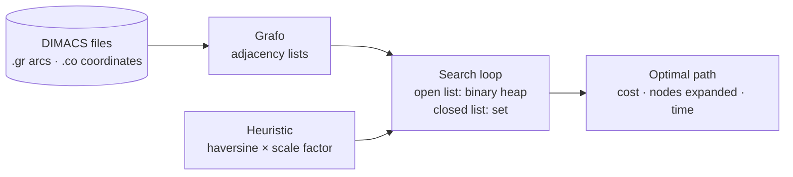

# A* on a Real Road Network

**Dijkstra and A* implemented from scratch on the San Francisco Bay Area road graph (321,270 nodes, 800,172 arcs), plus a constraint-satisfaction solver for a binary board puzzle.**

Heuristics and Optimization · BSc in Computer Science and Engineering · Universidad Carlos III de Madrid · December 2025

## Part 2: shortest paths on a road network

Given two intersections of the DIMACS `USA-road-d.BAY` graph, find the shortest route between them with Dijkstra and with A*, and compare how much work each one does.



- **Graph:** adjacency lists loaded from the DIMACS arc and coordinate files (coordinates are stored in millionths of a degree).
- **Open list:** a binary min-heap written by hand, with lazy deletion: stale entries are skipped when popped, if the node is already closed.
- **Closed list:** a set of expanded nodes.
- **Search:** one loop for both algorithms. Dijkstra is the same loop with `h = 0`.
- **Heuristic:** great-circle (haversine) distance to the target, scaled to the units of the edge costs (see below).

### Fixing the heuristic

The submitted version was correct, since A* always returned the optimal cost, but it barely beat Dijkstra. While preparing this repository I measured why: **the edge costs are in decimetres, while the haversine heuristic returned metres**, so it underestimated the remaining distance about tenfold and gave A* almost no guidance.

Multiplying by 10 is not safe, because some edges are shorter than the straight-line distance between their endpoints suggests. Instead, the heuristic is scaled by the smallest cost/distance ratio over all edges (**7.03** for this graph, computed once at start-up). With that factor the heuristic never overestimates any edge, so by the triangle inequality it stays **admissible and consistent**, and A* keeps returning optimal paths.

Results of `benchmark.py` over 20 random pairs (seed 0). All three variants found the same optimal cost on every pair:

| Variant | Nodes expanded (mean) | vs. Dijkstra | Time (mean) | vs. Dijkstra |
|---|---:|---:|---:|---:|
| Dijkstra | 164,089 | — | 0.65 s | — |
| A*, original heuristic (metres) | 151,410 | −8 % | 0.70 s | +6 % |
| **A*, scaled heuristic** | **76,625** | **−53 %** | **0.42 s** | **−36 %** |

Expanded nodes is the stable metric. Times are pure Python on one machine and vary by roughly ±15 % between runs. Computing the scale factor takes about 1.7 s, once per graph.

The fix is in its own commit, after the submitted version, so the history shows both.

## Part 1: constraint satisfaction

A binary puzzle on an *n × n* board: every cell must be black (`X`) or white (`O`), some cells are given, each row and column has as many black cells as white ones, and no three consecutive cells in a row or column share a colour. It is modelled as a CSP with `python-constraint` (one variable per cell, exact-sum constraints per row and column, and a constraint per triple of consecutive cells). The solver prints the number of solutions and writes the first one.

```
input            first of 9 solutions
.X...X           O X X O O X
..X..O           O X X O X O
.O..X.           X O O X X O
O.X...           O O X X O X
.X.O..           X X O O X O
X.....           X O O X O X
```

## Running it

Requirements: Python 3. Part 2 uses only the standard library.

```bash
pip install -r requirements.txt            # python-constraint, for part 1

cd parte-1
python parte-1.py ejemplo.in salida.out

cd ../parte-2
python parte-2.py 1 309 data/USA-road-d.BAY solucion   # source, target, map, output file
python benchmark.py data/USA-road-d.BAY 20              # Dijkstra vs. A* on 20 random pairs
```

The graph is shipped gzipped in `parte-2/data/` and read directly. The output file lists the path as `node-(cost)-node-…`.

## Context

- **Course project**, done in a pair. The code, comments and console output are in Spanish.
- **Data:** `USA-road-d.BAY` from the [9th DIMACS Implementation Challenge](http://www.diag.uniroma1.it/challenge9/), derived from US Census TIGER/Line data.
- **After the submission:** the heuristic fix, the benchmark, input validation and the packaging were added in October 2026 with AI assistance (Claude Code). The original submission is the commit "Complete both parts (report pending)".
